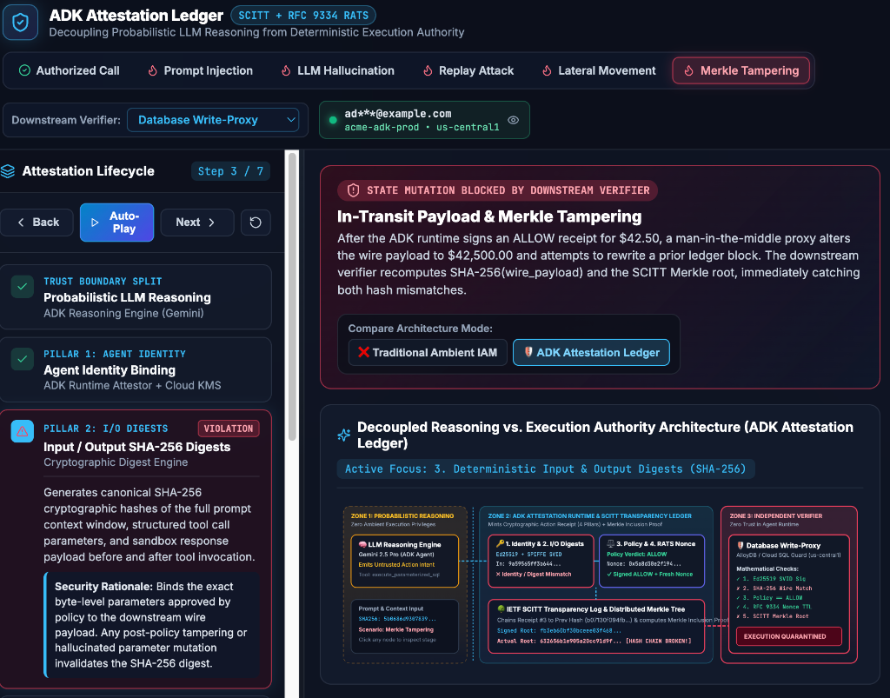

<!--
  SPDX-License-Identifier: MIT
  Copyright (c) 2026 Contributors

  DISCLAIMER: THIS FILE IS PROVIDED "AS IS", WITHOUT WARRANTY OF ANY KIND,
  EXPRESS OR IMPLIED, INCLUDING BUT NOT LIMITED TO THE WARRANTIES OF
  MERCHANTABILITY, FITNESS FOR A PARTICULAR PURPOSE AND NONINFRINGEMENT.
  IN NO EVENT SHALL THE AUTHORS OR COPYRIGHT HOLDERS HAVE ANY RESPONSIBILITY
  OR LIABILITY FOR ANY CLAIM, DAMAGES OR OTHER LIABILITY ARISING FROM, OUT OF,
  OR IN CONNECTION WITH THIS FILE OR THE SOFTWARE OR THE USE OR OTHER DEALINGS
  IN THE SOFTWARE.
-->

# ADK Attestation Ledger — Interactive Architecture Simulator

[](./LICENSE)

> **Disclaimer:** This software and documentation are provided **"AS IS"**, without warranty of any kind, express or implied. The authors and copyright holders assume **no responsibility or liability** for any claim, damages, or other liability arising from, out of, or in connection with this software or its use. See the [LICENSE](./LICENSE) file for full details.
>
> **Visual Representation Notice:** All files, interactive simulators, cryptographic receipts, and code snippets in this repository are strictly for **visual representation and architectural education** to illustrate Zero Trust governance concepts.

An interactive 3-panel visual simulator and cryptographic inspector explaining how the **Agent Development Kit (ADK) Attestation Ledger** decouples probabilistic Large Language Model (LLM) reasoning from deterministic execution authority.

---

## Why Traditional Software Trust Breaks Down with LLMs

Traditional microservices rely on ambient credentials (IAM roles, OAuth tokens, mTLS certificates) attached to a process because deterministic code only executes paths explicitly written by engineers.

Large Language Models (LLMs), however, are **probabilistic** and process untrusted natural-language inputs alongside system instructions. This exposes agents to:
- **Prompt Injection:** Untrusted data (emails, web pages, RAG documents) hijacking the agent's control flow to invoke destructive tools (`DROP TABLE`, unauthorized transfers).
- **Hallucinated Parameters:** Probabilistic token generation synthesizing plausible-looking but invalid or out-of-policy tool arguments.
- **Lateral Movement & Replay Attacks:** Compromised pods or network interceptors invoking downstream APIs directly or replaying previously captured approval tokens.

The **ADK Attestation Ledger** solves this by treating the LLM strictly as an *untrusted proposer* and requiring a verifiable **Cryptographic Action Receipt** anchored in an append-only transparency ledger before any downstream state change is committed.

---

## Core Architectural Concepts Visualized

### 1. Cryptographic Action Receipts (The 4 Pillars)
Whenever an agent requests a tool execution, the ADK Runtime intercepts the call and assembles a signed receipt capturing four cryptographic pillars:
1. **Agent Identity (`Ed25519` / `SPIFFE SVID`):** Binds the tool invocation to a hardware- or KMS-backed asymmetric key (`Ed25519`) and workload identity (`spiffe://example.com/ns/adk-prod/sa/...`).
2. **Input/Output Digests (`SHA-256`):** Cryptographic hashes of the prompt context, canonicalized tool parameters, and response payload so parameters cannot be altered in transit.
3. **Policy Decision Proof (`ALLOW` / `DENY`):** A deterministic policy gateway (e.g., Cedar / OPA) evaluates hard security invariants outside the LLM and co-signs the verdict.
4. **Liveness Proofs (`RFC 9334 RATS`):** High-entropy freshness nonces and strict millisecond Time-To-Live (TTL) windows bound to the verifier's challenge to prevent replay attacks.

### 2. Hash-Chained & Merkle Architecture (`IETF SCITT`)
- Every receipt includes `prev_receipt_hash`, forming an immutable hash chain.
- Receipts are hashed as leaves ($L_0 \dots L_3$) into a binary **Merkle Tree** backed by an **IETF SCITT** (Supply Chain Integrity, Transparency, and Trust) transparency log.
- Using **Merkle Math** ($O(\log N)$ inclusion proofs), a downstream verifier only needs the target leaf hash and its sibling audit path (`[L2, N01]`) to recompute and verify the signed Merkle Root.

### 3. Independent Downstream Verifiability
Downstream systems (**Database Write-Proxies**, **Kubernetes Admission Controllers**, **Enterprise API Gateways**) do not trust the agent's runtime environment. They independently verify:
- Agent Passport `Ed25519` signature
- `SHA-256` wire payload digest match
- Policy Gateway `ALLOW` co-signature
- `RFC 9334 RATS` nonce freshness and single-use registry status
- `SCITT` Merkle Root inclusion proof

---

## Interactive Features

- **5 Interactive Security Scenarios:**
  1. **Authorized Tool Call:** Full 7-step happy path with all 5 mathematical checks passing.
  2. **Prompt Injection Attack:** Indirect prompt injection attempting `DROP TABLE` blocked by the Deterministic Policy Gateway (`DENY`).
  3. **Replay Attack (Stale Nonce):** Captured `ALLOW` receipt replayed 92 seconds later, rejected by RFC 9334 RATS freshness check.
  4. **Lateral Movement (Forged Key):** Compromised adjacent workload calling the proxy without a valid SPIFFE/Ed25519 Agent Passport signature.
  5. **Merkle / Payload Tampering:** Man-in-the-middle modifying wire parameters after signing, triggering an immediate SHA-256 and Merkle Root mismatch cascade.
- **Live Wire Payload Tamper Editor & Merkle Tree Inspector:** Edit raw JSON tool parameters or click any leaf node ($L_0$–$L_3$) in the SVG Merkle tree to watch SHA-256 hashes recompute in real time.
- **Trust Model Comparison Toggle:** Switch between *Traditional Ambient IAM* (vulnerable) and *ADK Attestation Ledger* (cryptographically gated).
- **Downstream Verifier Target Switcher:** Inspect enforcement across a **Database Write-Proxy**, **Kubernetes Admission Controller**, or **Enterprise API Gateway**.

---

## Additional Standalone Visual Demos

All HTML files in this repository are self-contained **visual representations** designed to demonstrate multi-agent Zero Trust architecture patterns directly in the browser:

### 1. 3-Level Multi-Agent Attestation & Chained Ledger (`adk_attestation_ledger_interactive_demo.html`)
An interactive presentation-ready visual simulator demonstrating end-to-end **Zero Trust Multi-Agent Governance** across three architectural levels and five topology nodes:
- **Level 1 — Origin & Intent Attestation (`Block H₀`):** The Root Entry Gateway authenticates the user's OIDC identity, hashes the initial prompt (`SHA-256`), and signs the root scope ceiling (`['db.read', 'analytics.query']`) using Cloud KMS.
- **Level 2 — ADK Multi-Agent Delegation Mesh (`Block H₁ → H₂`):** Visualizes how ADK lifecycle hooks (`before_tool_callback` and `before_agent_callback`) enforce **Monotonic Privilege Attenuation** ($\text{Scope}(H_2) \subseteq \text{Scope}(H_1) \subseteq \text{Scope}(H_0)$) when **Orchestrator Agent A** delegates tasks to **Sub-Agent B** (`AgentTool`).
- **Level 3 — Zero Trust Enforcement Perimeter (Tool / MCP Proxy):** Independently validates the full `H₀ → H₁ → H₂` signature chain, parent hash continuity, sequence nonces, and scope invariants before allowing queries against protected Cloud SQL resources.
- **Interactive Scenarios & Presenter Views:** Includes 3 live modes (**Mode A: Valid Execution**, **Mode B: Compromised Sub-Agent / Prompt Injection Scope Escalation**, and **Mode C: Replay & Out-of-Sequence Context Tampering**), alongside live **Presenter Notes**, a **Verification Matrix**, and **ADK Hook Pseudocode** tabs.

### 2. Cross-Boundary Agent-to-Agent (A2A) Zero Trust & Envelope Encryption (`google_adk_cross_boundary_a2a_zta_demo.html`)
A 5-step interactive visual simulator illustrating how the ADK Attestation Ledger secures **cross-perimeter Agent-to-Agent (A2A) communication** between two distinct trust boundaries (**Trust Boundary A** and **Trust Boundary B**):
- **Hardware-Locked KMS Isolation:** Demonstrates that private keys (`PrivKey_A` in Cloud KMS A and `PrivKey_B` in Cloud KMS B) never leave their respective VPC perimeters; only public keys are exchanged via **JWKS** (`PubKey_A`) and A2A **`AgentCard`** discovery (`/.well-known/agent.json` for `PubKey_B`).
- **Hybrid Envelope Encryption (`JWE` + `Ed25519`):** Orchestrator Agent A encrypts the outbound A2A task payload with an ephemeral `AES-256-GCM` Data Encryption Key (DEK), wraps the DEK using Boundary B's `PubKey_B`, and signs handoff block `H₁` with `PrivKey_A`.
- **Boundary B Policy Enforcement Point (`before_agent_callback`):** Remote Agent B verifies the `H₀ → H₁` lineage with `PubKey_A`, enforces monotonic scope (`Scope₁ ⊆ Scope₀`), unwraps the DEK locally inside Cloud KMS B (`PrivKey_B`), and verifies the plaintext `SHA-256` digest before invoking its LLM or querying the Protected Finance DB (`H₂`).
- **Interactive Attack Simulations:** Compare the **Valid ZTA Flow** against **Confused Deputy (Scope Escalation)** and **MITM Ciphertext / Key Tamper** attacks to see how unauthorized requests are dropped at the perimeter with zero blast radius.

---

## Project Structure

```text
.
├── LICENSE                                       # MIT License with AS-IS / No-Liability clause
├── README.md                                     # Architecture & usage documentation
├── index.html                                    # Vite entry point with strict CSP headers
├── package.json                                  # React 18, Vite 6, Lucide React dependencies
├── vite.config.js                                # Bound to 127.0.0.1:5173
├── adk-attestation-ledger-standalone.html        # Zero-dependency single-file HTML bundle (Core Simulator)
├── adk_attestation_ledger_interactive_demo.html  # Visual demo: 3-Level Multi-Agent Attestation & Chained Ledger
├── google_adk_cross_boundary_a2a_zta_demo.html   # Visual demo: Cross-Boundary A2A ZTA & KMS Envelope Encryption
└── src/
    ├── main.jsx                                  # React root mount
    ├── App.jsx                                   # 3-panel interactive simulator & SVG diagrams
    ├── App.css                                   # Dark-mode glassmorphic layout & animations
    └── ledgerData.js                             # Deterministic SHA-256 engine, Merkle tree & scenarios
```

---

## Getting Started

### Option 1: Run the Vite + React Development Server

1. **Install dependencies:**
   ```bash
   npm install
   ```

2. **Start the local development server (bound to `127.0.0.1:5173`):**
   ```bash
   npm run dev
   ```
   Open [http://127.0.0.1:5173/](http://127.0.0.1:5173/) in your browser.

3. **Build for production:**
   ```bash
   npm run build
   ```

### Option 2: Open the Standalone HTML Visual Demos

You can open any of the standalone HTML visual representation files directly in your browser without Node.js or a build step:
```bash
# 1. Core 3-Panel Cryptographic Receipt & Merkle Tree Simulator
open adk-attestation-ledger-standalone.html

# 2. 3-Level Multi-Agent Attestation & Monotonic Scope Chained Ledger Demo
open adk_attestation_ledger_interactive_demo.html

# 3. Cross-Boundary A2A Zero Trust & Cloud KMS Envelope Encryption Demo
open google_adk_cross_boundary_a2a_zta_demo.html
```

---

## License & Disclaimer

Licensed under the **MIT License** (see [LICENSE](./LICENSE)).

```text
THE SOFTWARE IS PROVIDED "AS IS", WITHOUT WARRANTY OF ANY KIND, EXPRESS OR
IMPLIED, INCLUDING BUT NOT LIMITED TO THE WARRANTIES OF MERCHANTABILITY,
FITNESS FOR A PARTICULAR PURPOSE AND NONINFRINGEMENT. IN NO EVENT SHALL THE
AUTHORS OR COPYRIGHT HOLDERS BE LIABLE FOR ANY CLAIM, DAMAGES OR OTHER
LIABILITY, WHETHER IN AN ACTION OF CONTRACT, TORT OR OTHERWISE, ARISING FROM,
OUT OF OR IN CONNECTION WITH THE SOFTWARE OR THE USE OR OTHER DEALINGS IN THE
SOFTWARE.
```

---

## Sample UI Preview



